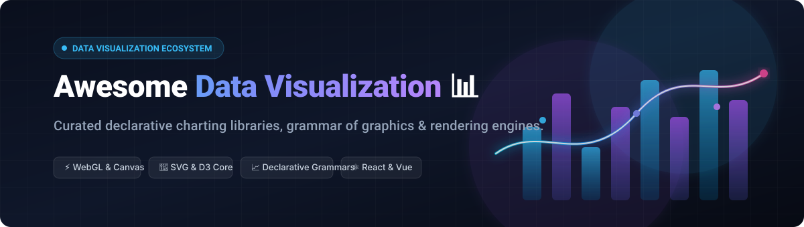
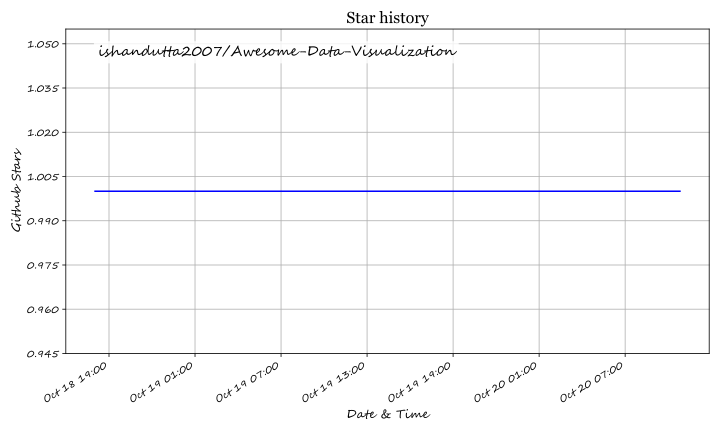

<div align="center">

# 📊 Awesome Data Visualization

[](https://github.com/ishandutta2007/Awesome-Awesome-Awesome)
<a href="https://discord.gg/jc4xtF58Ve"></a>
<a href="https://github.com/ishandutta2007/Awesome-Data-Visualization/stargazers"></a>
<a href="https://github.com/ishandutta2007/Awesome-Data-Visualization/network/members"></a>
<a href="https://github.com/ishandutta2007"></a>

<br />

<a href="#table-of-contents">
  
</a>

<p align="center">
  <strong>A curated index of premier declarative charting engines, Grammar of Graphics frameworks, and high-performance rendering toolkits.</strong>
</p>

<p align="center">
  <a href="#-sector-overview--market-dynamics">Sector Overview</a> •
  <a href="#-saashosted-platforms">SaaS Platforms</a> •
  <a href="#-open-source-github-projects">Open-Source Projects</a> •
  <a href="#-how-to-contribute">Contributing</a> •
  <a href="#-star-history">Star History</a> •
  <a href="#-support--sponsorship">Support</a>
</p>

</div>

---

## 📖 Overview

Welcome to the definitive guide to the **Data Visualization Ecosystem**. This repository provides an extensively researched reference tracking prominent **commercial SaaS platforms** and **open-source GitHub libraries** designed for modern web engineering, data science, and business intelligence.

Whether you need pixel-perfect low-level primitives to draw bespoke graphics, grammar-of-graphics abstractions to build exploratory analytics, or WebGL-accelerated engines handling millions of real-time streaming datapoints, this list categorizes the state of the art in modern visual interfaces.

> **Key Focus Areas:** Declarative APIs, DOM vs. Canvas vs. WebGL/WebGPU rendering, Grammar of Graphics, cross-platform React/Vue support, enterprise accessibility (WCAG), and responsive chart design.

---

## 📑 Table of Contents

- [🌐 Sector Overview & Market Dynamics](#-sector-overview--market-dynamics)
- [💼 SaaS/Hosted Platforms](#-saashosted-platforms)
- [🚀 Open-Source GitHub Projects](#-open-source-github-projects)
  - [1. D3.js](#1-d3js-)
  - [2. Chart.js](#2-chartjs-)
  - [3. Apache ECharts](#3-apache-echarts-)
  - [4. Recharts](#4-recharts-)
  - [5. Visx (Airbnb)](#5-visx-airbnb-)
  - [6. Plotly.js](#6-plotlyjs-)
  - [7. ApexCharts](#7-apexcharts-)
  - [8. Frappe Charts](#8-frappe-charts-)
  - [9. Nivo](#9-nivo-)
  - [10. G2 (AntV)](#10-g2-antv-)
  - [11. G6 (AntV Graph)](#11-g6-antv-graph-)
  - [12. Vega](#12-vega-)
  - [13. Victory](#13-victory-)
  - [14. uPlot](#14-uplot-)
  - [15. Billboard.js](#15-billboardjs-)
  - [16. Vega-Lite](#16-vega-lite-)
  - [17. Observable Plot](#17-observable-plot-)
  - [18. Dygraphs](#18-dygraphs-)
- [💡 Architectural Guidance: Choosing the Right Tool](#-architectural-guidance-choosing-the-right-tool)
- [🤝 How to Contribute](#-how-to-contribute)
- [⚠️ Disclaimer](#️-disclaimer)
- [⭐ Star History](#-star-history)
- [💖 Support & Sponsorship](#-support--sponsorship)

---

## 🌐 Sector Overview & Market Dynamics

The global data visualization market size is estimated at approximately **$11.8B – $13.7B in 2026** (projected to reach over **$22B by 2030** at an ~11% CAGR). 

The sector dynamics present a dual structure:
- **Moderately Concentrated Core**: Dominated at the enterprise Business Intelligence (BI) and operational reporting tier by major suites such as Microsoft Power BI, Tableau (Salesforce), Qlik, and Google Looker.
- **Fragmented Developer Ecosystem**: Deeply fragmented across embedded charting engines, grammar-of-graphics toolchains, and bespoke front-end libraries where self-hosted and open-source solutions continuously innovate to satisfy specialized speed, canvas rendering, accessibility, and bundle-size requirements.

---

## 💼 SaaS/Hosted Platforms

| Product | Valuation / Revenue | Starting Pricing | Free Tier Limits | Description |
| :--- | :--- | :--- | :--- | :--- |
| **Highcharts** | ~$8M annual revenue (Highsoft AS) | $185 – $400/developer/year (Internal License); $500+/developer (Web/SaaS License) | Unlimited perpetual use for non-commercial/personal use, schools, and local non-production evaluation; commercial deployment requires a paid license. | Pure JavaScript/TypeScript charting suite trusted by 80 of Fortune 100 companies. Zero external dependencies, WebGL/WebGPU acceleration, and full WCAG accessibility. |

---

## 🚀 Open-Source GitHub Projects

The leading open-source data visualization libraries, ranked in descending order by GitHub stargazer popularity:

### 1. [D3.js](https://github.com/d3/d3) [](https://github.com/d3/d3/stargazers)
- **License**: ISC
- **Description**: **The foundational JavaScript library for manipulating documents based on data using HTML, SVG, and CSS.** D3 is the low-level visualization standard that nearly every modern charting framework is either built upon or inspired by. Rather than exposing rigid chart templates, D3 binds arbitrary data arrays to the DOM and executes declarative transformations.
- **Key Strengths**: Complete pixel-level rendering control, expressive geographical projections, robust physics-based force layouts, and extensive math/hierarchy modules.
- **Best For**: Bespoke animations, specialized data storytelling, and custom graphical visualizations that conventional pre-canned charting libraries cannot represent.

---

### 2. [Chart.js](https://github.com/chartjs/Chart.js) [](https://github.com/chartjs/Chart.js/stargazers)
- **License**: MIT
- **Description**: **Simple, clean, and flexible HTML5 Canvas charting for designers and frontend developers.** Chart.js provides 8 core responsive chart types (bar, line, radar, pie, doughnut, polar area, bubble, and scatter) with smooth canvas animations out of the box.
- **Key Strengths**: Zero-configuration setup, lightweight bundle size, out-of-the-box responsiveness, mixed chart capabilities, and official integrations for React, Vue, and Angular.
- **Best For**: Fast MVP development, admin panels, customer dashboards, and applications demanding attractive charts rendering within minutes.

---

### 3. [Apache ECharts](https://github.com/apache/echarts) [](https://github.com/apache/echarts/stargazers)
- **License**: Apache-2.0
- **Description**: **A powerful, interactive charting and visualization library engineered for enterprise scale by the Apache Software Foundation.** It powers critical data infrastructures worldwide (including Apache Superset) and offers dual SVG and Canvas rendering engines alongside WebGL-based extensions.
- **Key Strengths**: Handles streaming datasets with hundreds of thousands of datapoints, includes built-in multi-dimensional data zooming, supports rich 3D charts and geographic maps, and provides accessible audio charting.
- **Best For**: Enterprise-grade analytical dashboards, complex multi-coordinate relational charts, and high-frequency real-time telemetry.

---

### 4. [Recharts](https://github.com/recharts/recharts) [](https://github.com/recharts/recharts/stargazers)
- **License**: MIT
- **Description**: **A redefined, composable charting library built from the ground up with React and D3.** Recharts exposes charting primitives as native, declarative React components (`<ResponsiveContainer>`, `<LineChart>`, `<XAxis>`, `<Tooltip>`) that compose naturally with state and props.
- **Key Strengths**: Pure SVG rendering for crystal-clear fidelity at any resolution, painless integration into modern React/Next.js design systems, and highly customizable child components.
- **Best For**: Modern React web applications where charts must fit cleanly into component lifecycles and styling architectures.

---

### 5. [Visx (Airbnb)](https://github.com/airbnb/visx) [](https://github.com/airbnb/visx/stargazers)
- **License**: MIT
- **Description**: **A collection of reusable, low-level visualization primitives for React developed by Airbnb.** Visx bridges the gap between raw D3 and monolithic charting libraries by dividing D3's capabilities into tiny, independent React packages (e.g., `@visx/shape`, `@visx/scale`, `@visx/axis`).
- **Key Strengths**: Bring-your-own-state and bring-your-own-animation philosophy, modular bundle imports, unopinionated styling, and complete TypeScript typings.
- **Best For**: Engineering teams building custom internal design systems and bespoke charting components with React idioms.

---

### 6. [Plotly.js](https://github.com/plotly/plotly.js) [](https://github.com/plotly/plotly.js/stargazers)
- **License**: MIT
- **Description**: **The open-source JavaScript graphing library behind Plotly and Dash.** Built on top of D3.js and WebGL, Plotly.js ships with over 40 diverse chart types spanning statistical, financial, 3D, and geographic mapping distributions.
- **Key Strengths**: Native LaTeX/MathJax mathematical formula rendering, WebGL-accelerated 3D surface and mesh plots, financial candlestick charts, and seamless parity with Python and R Plotly toolchains.
- **Best For**: Scientific visualization, bioinformatics, quantitative finance, and statistical research applications.

---

### 7. [ApexCharts](https://github.com/apexcharts/apexcharts.js) [](https://github.com/apexcharts/apexcharts.js/stargazers)
- **License**: MIT
- **Description**: **Modern SVG-based interactive charting library with exceptional default aesthetics and animations.** Features a tree-shakeable core and wrappers for React, Vue, Svelte, and Angular.
- **Key Strengths**: Sleek micro-interactions, responsive breakpoints, synchronized tooltips across multiple chart instances, sparkline mini-charts, and heatmaps.
- **Best For**: Polished SaaS management portals, executive overview dashboards, and customer-facing metrics screens.

---

### 8. [Frappe Charts](https://github.com/frappe/charts) [](https://github.com/frappe/charts/stargazers)
- **License**: MIT
- **Description**: **Simple, responsive, modern SVG charts with zero dependencies.** Inspired by GitHub-style contribution heatmaps and clean minimalistic typography.
- **Key Strengths**: Ultra-lightweight (~16KB gzipped), zero external dependencies, easy integration with vanilla JavaScript, and native export to SVG images.
- **Best For**: Lightweight blogs, documentation pages, developer metric displays, and minimal UI widgets.

---

### 9. [Nivo](https://github.com/plouc/nivo) [](https://github.com/plouc/nivo/stargazers)
- **License**: MIT
- **Description**: **Rich data visualization components for React built on top of D3.** Nivo features hybrid SVG, HTML, and Canvas rendering pipelines, alongside seamless server-side rendering (SSR) compatibility.
- **Key Strengths**: Beautiful motion physics powered by `@react-spring`, extensive color gradient and pattern customization, responsive wrappers, and code generator documentation.
- **Best For**: Design-first React projects where motion graphics, sankey diagrams, treemaps, and calendar heatmaps must look exquisite out of the box.

---

### 10. [G2 (AntV)](https://github.com/antvis/G2) [](https://github.com/antvis/G2/stargazers)
- **License**: MIT
- **Description**: **A highly interactive, data-driven visualization grammar developed by the Ant Group AntV team.** Grounded in Leland Wilkinson's *The Grammar of Graphics*, G2 provides a declarative JSON/functional API to build arbitrary graphic representations.
- **Key Strengths**: Declarative syntax mapping dataset columns directly to visual channels, dual Canvas/SVG rendering engines, complete TypeScript typings, and rich interaction grammar.
- **Best For**: Complex multi-dimensional data analysis, enterprise business intelligence platforms, and developers seeking grammar-of-graphics rigor.

---

### 11. [G6 (AntV Graph)](https://github.com/antvis/g6) [](https://github.com/antvis/g6/stargazers)
- **License**: MIT
- **Description**: **A graph visualization engine for relational and network data analysis.** Designed specifically for knowledge graphs, entity relationships, topology diagrams, and network flows.
- **Key Strengths**: Built-in graph layout algorithms (Force, Circular, Radial, Dagre, Orthogonal), high-performance WebGL graph rendering, and customizable node and edge styles.
- **Best For**: Network topology mapping, knowledge graph exploration, fraud detection visualizations, and workflow DAG builders.

---

### 12. [Vega](https://github.com/vega/vega) [](https://github.com/vega/vega/stargazers)
- **License**: BSD-3-Clause
- **Description**: **A declarative visualization grammar defining visual appearance and interactive behavior in standard JSON specifications.** Vega operates as a visualization compiler executing on top of Canvas or SVG.
- **Key Strengths**: Cross-platform declarative JSON format, reproducible data transformation pipelines, integrated spatial projections, and web-embeddable interactive widgets.
- **Best For**: Academic research, multi-platform visualization platforms, programmatic charting backends, and data science platforms.

---

### 13. [Victory](https://github.com/FormidableLabs/victory) [](https://github.com/FormidableLabs/victory/stargazers)
- **License**: MIT
- **Description**: **Composable React and React Native components for interactive data visualizations, crafted by Formidable Labs.**
- **Key Strengths**: Unified API sharing identical charting code across Web (React) and Mobile (React Native with react-native-svg), independent theming scales, and flexible gesture recognition.
- **Best For**: Universal cross-platform applications targeting both web dashboards and native iOS/Android mobile apps.

---

### 14. [uPlot](https://github.com/leeoniya/uPlot) [](https://github.com/leeoniya/uPlot/stargazers)
- **License**: MIT
- **Description**: **An extraordinarily fast, memory-efficient Canvas-based 2D chart for time series, lines, areas, OHLC, and bars.** uPlot routinely outperforms alternatives by 10x–50x on giant datasets.
- **Key Strengths**: Weighs ~40KB with zero external dependencies, renders 150,000 points in ~25 milliseconds, and features minimal memory overhead.
- **Best For**: High-frequency financial trading desks, IoT sensor streaming, server infrastructure telemetry, and real-time monitoring suites.

---

### 15. [Billboard.js](https://github.com/naver/billboard.js) [](https://github.com/naver/billboard.js/stargazers)
- **License**: Apache-2.0
- **Description**: **Re-usable, easy interface JavaScript chart library based on D3.js v4+, maintained by NAVER.** Billboard.js is the modern, actively supported successor to C3.js.
- **Key Strengths**: Intuitive declarative option configurations, automatic D3 lifecycle management, and broad support for line, bar, pie, radar, and candlestick chart types.
- **Best For**: Teams seeking the simplicity of C3.js with modern D3 support, tree-shaking, and enterprise maintenance.

---

### 16. [Vega-Lite](https://github.com/vega/vega-lite) [](https://github.com/vega/vega-lite/stargazers)
- **License**: BSD-3-Clause
- **Description**: **A high-level concise visualization grammar that compiles down to lower-level Vega specifications.** Powers Altair in Python and is widely adopted across computational notebook ecosystems.
- **Key Strengths**: Extremely compact syntax expressing layered, faceted, and concatenated multi-view plots with linked interactive brushing and filtering.
- **Best For**: Rapid exploratory data analysis, interactive statistical graphics, and data science workflows.

---

### 17. [Observable Plot](https://github.com/observablehq/plot) [](https://github.com/observablehq/plot/stargazers)
- **License**: ISC
- **Description**: **A concise, modern JavaScript library for exploratory data visualization created by Mike Bostock and the Observable team.**
- **Key Strengths**: Concise marks-based grammar (`Plot.dot`, `Plot.line`, `Plot.rect`), automatic scales and legends, sensible visual defaults, and seamless integration with web standards.
- **Best For**: Data journalism, fast prototyping, internal data science presentations, and notebook-based workflows.

---

### 18. [Dygraphs](https://github.com/danvk/dygraphs) [](https://github.com/danvk/dygraphs/stargazers)
- **License**: MIT
- **Description**: **A battle-tested, fast, and flexible open-source JavaScript charting library built to handle massive time series datasets.**
- **Key Strengths**: Pinch-to-zoom on mobile devices, interactive panning, error bar bands, and robust handling of missing timestamp values.
- **Best For**: Scientific equipment recording, historical stock tickers, and legacy high-density time-series monitoring.

---

## 💡 Architectural Guidance: Choosing the Right Tool

```
                                    What is your primary requirement?
                                                  │
                 ┌────────────────────────────────┼────────────────────────────────┐
                 ▼                                ▼                                ▼
         Custom Visuals                    Fast Standard                    Millions of
      (Bespoke / Artistic)                    Charts                         Datapoints
                 │                                │                                │
                 ▼                                ▼                                ▼
             [ D3.js ]                 ┌──────────┴──────────┐                 [ uPlot ]
         or [ Visx (React) ]           ▼                     ▼            or [ Apache ECharts ]
                                  (React App)          (Vanilla / Any)
                                       │                     │
                                       ▼                     ▼
                                  [ Recharts ]          [ Chart.js ]
                                  or [ Nivo ]         or [ ApexCharts ]
```

- **Maximum Expressive Control**: Choose **[D3.js](https://github.com/d3/d3)** or **[Visx](https://github.com/airbnb/visx)** if you need unique geometry, custom SVG filters, or bespoke storytelling graphics.
- **Speed to Market**: Choose **[Chart.js](https://github.com/chartjs/Chart.js)**, **[Recharts](https://github.com/recharts/recharts)**, or **[ApexCharts](https://github.com/apexcharts/apexcharts.js)** for turnkey responsive charts and clean UI aesthetics.
- **Big Data & Real-Time Performance**: Choose **[uPlot](https://github.com/leeoniya/uPlot)** or **[Apache ECharts](https://github.com/apache/echarts)** when streaming tens or hundreds of thousands of data points at 60 FPS.
- **Grammar of Graphics Rigor**: Choose **[Vega-Lite](https://github.com/vega/vega-lite)**, **[G2](https://github.com/antvis/G2)**, or **[Observable Plot](https://github.com/observablehq/plot)** for principled data-to-mark mappings.

---

## 🤝 How to Contribute

Contributions, suggestions, and corrections are warmly welcomed! 🌟

1. 🍴 **Fork** the repository to your own GitHub account.
2. 🌿 **Create a new branch** (`git checkout -b feature/add-new-visualization-tool`).
3. 📝 **Add your entry** under the appropriate section following the existing markdown formatting, Stars_Count, and license conventions.
4. 🚀 **Commit your changes** (`git commit -m 'feat: add CoolViz library'`).
5. 📬 **Push and open a Pull Request** with a brief summary of why the library is notable.

---

## ⚠️ Disclaimer

- This list is **community-curated** for educational and architectural reference—not an official product endorsement.
- Verify software licenses and evaluation restrictions before enterprise adoption (e.g., Highcharts requires a commercial license for revenue-generating products).

---

## ⭐ Star History

[](https://star-history.dera.page/#ishandutta2007/Awesome-Data-Visualization&type=date&legend=top-left)

---

## 💖 Support & Sponsorship

Thank you for exploring and bookmarking **Awesome Data Visualization**! If this curated collection helps accelerate your engineering decisions or powers your analytics projects, please consider supporting the project:

- ⭐ **Star this repository** to help other developers discover it!
- 🍴 **Fork and share** it across your team, community, and social networks.
- ☕ **Support the maintainer**: If you would like to buy a coffee or sponsor ongoing maintenance, please visit the [**GitHub Sponsors Dashboard**](https://github.com/sponsors/ishandutta2007).

## ⭐ Star History

<a href="https://star-history.com/#ishandutta2007/Awesome-Data-Visualization&Timeline" align="center">
  <picture>
    <source media="(prefers-color-scheme: dark)" srcset="assets/ishandutta2007_Awesome-Data-Visualization_growth.svg">
    
  </picture>
</a>
